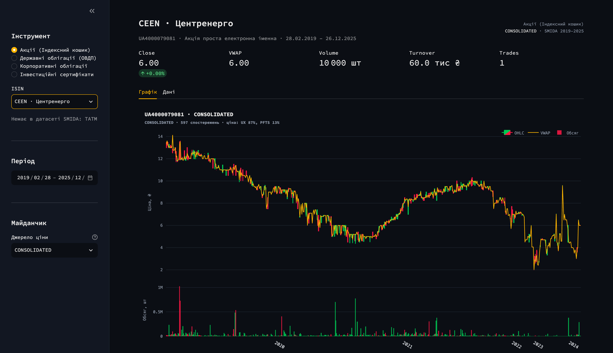

[](https://ukrainian-consolidated-tape.streamlit.app)

# Ukrainian Consolidated Tape (UCT)

**Open-Source Engine for Exchange Trading Microstructure Data in Ukraine (2019–2025)**



[](https://www.python.org/)
[](https://arrow.apache.org/docs/python/)
[](https://click.palletsprojects.com/)
[](https://streamlit.io/)

An end-to-end, reproducible pipeline that turns the official exchange disclosures of
the Ukrainian securities market — published through **SMIDA** (the national
securities depository's disclosure database) — into an analysis-ready,
cross-exchange **consolidated tape**.

The project reconstructs daily OHLCV bars per instrument and per trading venue, and
then consolidates them into a single microstructure series following the
cross-exchange consolidation model developed in the doctoral research of
**Stanislav Fishchuk**. It is, to the author's knowledge, the first openly
documented, fully reproducible consolidation engine for Ukrainian organised capital
markets.

---

## 1. Research context

| | |
|---|---|
| **Project** | Ukrainian Consolidated Tape (UCT) |
| **Field** | Market microstructure, exchange trading activity, organised commodity and capital markets |
| **Speciality** | **076 «Підприємництво, торгівля та біржова діяльність»** (Entrepreneurship, Trade and Exchange Activity) |
| **Institution** | **Taras Shevchenko National University of Kyiv** |
| **Author** | Stanislav Fishchuk |
| **Period covered** | 01.01.2019 – 31.12.2025 |
| **Venues consolidated** | PJSC/AT **PFTS** («Фондова біржа ПФТС»), **Perspektyva** («Перспектива»), **Ukrainian Exchange** («Українська біржа») |

### Scientific value

1. **First open, reproducible consolidation of Ukrainian exchange data.** No public
   consolidated tape existed for Ukraine; exchange activity is disclosed
   venue-by-venue in heterogeneous, semi-structured regulatory filings.
2. **A documented data-engineering method** for a national disclosure registry:
   session-bound search forms, CSRF tokens, duplicated contract rows, silent
   unfiltered responses, and server-side rendering limits are all handled explicitly
   rather than papered over.
3. **A measurable, auditable consolidation rule** — every consolidated bar records
   *which venue* set its price (`price_source`), so the modelling assumption can be
   tested rather than trusted.
4. **A reusable dataset and benchmark** for studies of liquidity, price discovery
   and market fragmentation in a frontier capital market.

---

## 2. Results (full run of 31.10.2026)

| Metric | Value |
|---|---|
| Exchange reports discovered & parsed | **4,859** of 4,869 — **99.8 % coverage** |
| Raw contract rows ingested | 1,737,224 |
| **Deduplicated transactions** | **620,389** (570,380 spot · 50,009 REPO legs) |
| Daily OHLCV bars (per venue) | 84,057 |
| **Consolidated bars** | **58,546** |
| **Financial instruments** | **757** |
| Consolidated price source | PFTS 31,487 · Perspektyva 14,536 · UX 12,523 |
| Consolidated tape span | 2019-02-28 → 2025-12-31 |
| Integrity checks | 0 non-positive prices · 0 infinite returns · `Low ≤ Close ≤ High` always |

### Reports per year and venue

| Year | PFTS | Perspektyva | UX | Total |
|---|---:|---:|---:|---:|
| 2019 | 209 | 203 | 211 | 623 |
| 2020 | 249 | 249 | 253 | 751 |
| 2021 | 250 | 251 | 246 | 747 |
| 2022 | 256 | 262 | 260 | 778 |
| 2023 | 260 | 265 | 261 | 786 |
| 2024 | 262 | 262 | 135 | 659 |
| 2025 | 261 | 264 | 0 | 525 |
| **Total** | **1,747** | **1,756** | **1,366** | **4,869** |

Coverage boundaries are properties of the **source**, not of the pipeline:

* **2015–2018** — SMIDA holds no `DisclExch` (daily exchange data) filings at all;
  the tape therefore begins in 2019.
* **UX after 05.07.2024** — the exchange stopped publishing daily data.
* **10 reports (May–Dec 2022)** — the registry's HTML renderer returns
  `504 Gateway Timeout` for these oversized filings and never published their XML
  twin. They remain queued in `error` state and can be re-ingested later with
  `extract --retry-errors`.

---

## 3. Architecture

```
crawler.py ──► storage/metadata.db ──► extractor.py ──► storage/raw_trades.parquet
                                                              │
                                                              ▼
                                        aggregator_and_consolidate.py
                                                              │
                                                              ▼
                                        output/consolidated_tape_2015_2025.parquet
                                                              │
                                                              ▼
                                                     dashboard.py (Streamlit)
```

```
smida_tape/
├── config.py                        # venues, EDRPOU codes, periods, paths, rate limits
├── parsing.py                       # HTML (selectolax/lexbor) + XML parsers, numeric/date normalisation
├── http_client.py                   # httpx AsyncClient (HTTP/2), rate limiter, CSRF session, tenacity
├── db.py                            # SQLite work queue (reports_queue) with migrations
├── crawler.py                       # Module 1 — report discovery
├── extractor.py                     # Module 2 — trade tape → partitioned Parquet
├── parquet_io.py                    # schema, partitioning, atomic dataset rewrite
├── aggregator_and_consolidate.py    # Module 3 — OHLCV, consolidation, log-returns
└── cli.py                           # click CLI
dashboard.py                         # Streamlit + Plotly candlestick explorer
tests/                               # 52 unit tests + real SMIDA fixtures
Dockerfile · docker-compose.yml · Makefile · pyproject.toml · requirements.txt
```

**Tech stack:** Python 3.11+ · `httpx` (async, HTTP/2) · `selectolax` (lexbor) +
`xml.etree` · `pandas` · **PyArrow / Parquet** (Zstd, partitioned) · **Click** CLI ·
**Streamlit** + **Plotly** dashboard · `tenacity` retries · `sqlite3` queue.

---

## 4. Engineering notes from the source registry

These are the non-obvious behaviours that shaped the implementation. Each was
verified against live SMIDA pages.

| Finding | Consequence in UCT |
|---|---|
| The search form is a **Symfony GET form protected by a CSRF token bound to a session cookie**. Requesting it without both returns `200 OK` with the *global, unfiltered* feed — silently wrong data, not an error. | The client bootstraps a session, caches `cabinet_report_search[_token]`, and **validates every result page** against the expected EDRPOU before accepting it. |
| The machine-readable **`report.xml`** twin of each filing is a static file: ~0.1 s regardless of size, versus 0.5–60 s for the rendered HTML form. | `--source auto` prefers XML and falls back to HTML. Heavy 2022 filings are only obtainable this way. XML exists **only from mid-2022**. |
| “Українська біржа” files under EDRPOU **36184092**, not 34914352. | Both codes are aliases; a name-based fallback covers unknown re-registrations. |
| **Every contract is listed twice** in a filing (both sides of the trade). | Exact duplicates are removed *within a report*; the same trade reported by different filings is preserved. Skipping this doubles volume and trade counts. |
| The HTML renderer is fragile: 8 concurrent requests push it into 20–60 s responses and `504`s, while single requests stay at 0.5 s. | Default concurrency is **3 workers @ 2 req/s**; `504` and read timeouts are *deferred* (not retried in-pass), with a global cooldown after repeated failures. |
| Some filings legitimately disclose “no contracts were executed”. | Parsed as a valid **zero-row** report, not as an error. |
| `robots.txt` disallows automated access. | The client identifies itself, keeps ≤ 5 req/s (default 2), honours `Retry-After`, and is intended solely for academic reproduction with minimal load. |

---

## 5. Methodology

### 5.1 Daily bars — per instrument, per venue

For each `(trade_date, exchange_code, instrument_key)`:

| Field | Definition |
|---|---|
| `open` / `close` | price of the first / last trade of the day (document order; SMIDA publishes no intraday timestamps) |
| `high` / `low` | max / min price |
| `volume_units` | Σ quantity |
| `turnover_uah` | Σ (quantity × price) |
| `vwap` | turnover / volume |
| `trades_count` | number of trades |

### 5.2 Cross-exchange consolidation (Fishchuk model)

For each instrument and day:

* **Volume** — `V_cons = V_PFTS + V_UX` if the sum is positive, otherwise
  `V_Perspektyva`;
* **Price** — the price of the venue with the larger volume among PFTS/UX; if both
  are zero, the Perspektyva price; ties are resolved in favour of PFTS (documented
  modelling choice, one line to change);
* **Return** — `R_t = ln(P_cons,t / P_cons,t−1)`, chained over consecutive
  observations of the instrument (gaps are not interpolated).

Every consolidated row carries `price_source` and `volume_source`, so any modelling
assumption is auditable. Example (`UA4000227193`, 2024-07-04): PFTS 1 unit @
1131.13, UX 24 units @ 1127.85 → `price_cons = 1127.85`, `price_source = UX`.

### 5.3 Data-quality handling

* Instruments are keyed by **ISIN**; malformed/empty ISINs fall back to
  `issuer_edrpou:instrument_type` so no trade is silently dropped.
* Rows with `price ≤ 0`, `quantity ≤ 0` or unparsable dates are excluded and
  counted in `output/aggregation_report.json`.
* `instrument_type` sourced from XML carries its provenance, e.g.
  `Облігація (CFI DBFTFR, код НКЦПФР 01120244)`, and is enriched from the free-text
  HTML description whenever the same ISIN was seen there.

---

## 6. Quick start

### Local (Python 3.11+)

```bash
python3 -m venv .venv && source .venv/bin/activate
pip install -r requirements.txt
pip install -e ".[dev,dashboard]"

python -m smida_tape initdb
python -m smida_tape crawl     --start 2019-01-01 --end 2025-12-31
python -m smida_tape extract   --workers 3 --source auto --retry-errors
python -m smida_tape aggregate --year-from 2015 --year-to 2025

python -m smida_tape status --by-year          # queue statistics
streamlit run dashboard.py                     # http://localhost:8501
```

Or the whole chain in one command:

```bash
python -m smida_tape --rps 2 pipeline --start 2019-01-01 --end 2025-12-31
```

### Docker (background, macOS ARM native)

```bash
docker compose up -d --build      # crawl → extract → aggregate
docker compose logs -f
```

`./storage` and `./output` are bind-mounted to the host, so the container can be
restarted freely without losing the queue or the datasets.

### CLI

| Command | Purpose |
|---|---|
| `crawl` | discover filings → `reports_queue` (`--exchange`, `--start`, `--end`, `--workers`) |
| `extract` | download & parse → `storage/raw_trades.parquet` (`--source auto\|html\|xml`, `--retry-errors`, `--limit`, `--dry-run`) |
| `aggregate` | daily bars + consolidated tape (`--price close\|vwap`, `--keep-duplicates`) |
| `pipeline` | crawl → extract → aggregate |
| `status` | queue statistics (`--by-year` for year × venue / year × status matrices) |
| `requeue` | move `error` (or all) reports back to `pending` |
| `parse-html FILE` | offline debugging of a saved SMIDA page |

Global options: `--home` (data root, `SMIDA_HOME`), `--rps` (≤ 5, default 2),
`--log-level`.

### Configuration

All runtime tuning is environment-driven (12-factor). Defaults are safe; override
via shell or `docker-compose.yml`:

| Variable | Default | Meaning |
|---|---|---|
| `SMIDA_HOME` | `.` | base directory for `storage/` and `output/` |
| `SMIDA_MAX_RPS` | `2` | requests per second (hard-capped at 5) |
| `SMIDA_TIMEOUT` | `60` | per-request timeout, seconds |
| `SMIDA_RETRIES` | `5` | retry attempts per request |
| `SMIDA_SLOW_AFTER` | `5` | consecutive failures before a global cooldown |
| `SMIDA_COOLDOWN` | `60` | upper bound of that pause, seconds |
| `SMIDA_CHECKPOINT_EVERY` | `250` | reports parsed between dataset checkpoints |
| `SMIDA_LOG_LEVEL` | `INFO` | logging verbosity |

> No `.env` file is shipped or required — the defaults work out of the box. Provide
> credentials/overrides through your own environment, never through the repository.

---

## 7. Outputs

| Path | Contents |
|---|---|
| `storage/metadata.db` | SQLite queue: report id, venue, EDRPOU, dates, status, transport, error |
| `storage/raw_trades.parquet` | cleaned trade tape, partitioned `year=/exchange_code=` (Zstd) |
| `output/consolidated_tape_2015_2025.parquet` | **the consolidated tape** (model output) |
| `output/daily_bars.parquet` | daily OHLCV per instrument and venue |
| `output/spot_tape_2015_2025.parquet` | spot trades only (`repo_part == '-'`) |
| `output/repo_tape_2015_2025.parquet` | REPO legs, kept separately for money-market work |
| `output/aggregation_report.json` | counters, date span, price/volume source distribution |

### What is committed, and why

The repository is code-first: `storage/`, `logs/`, the raw tape and the derived
spot/REPO splits are **git-ignored** and always regenerated by the pipeline.

Two files are the deliberate exception, because the hosted dashboard has no access
to the crawl:

| Committed file | Size | Reason |
|---|---|---|
| `output/consolidated_tape_2015_2025.parquet` | ~1.8 MB | the published model output the Streamlit app renders |
| `output/daily_bars.parquet` | ~2.5 MB | per-venue OHLCV — required for per-exchange candle mode and for `price_source`-aware candles |

These two files are a **frozen academic benchmark**: the 2019–2025 window is closed,
so the published tape is committed once and never mutated by automation. That keeps
every figure in §2 reproducible from an exact commit. Everything else
(`storage/metadata.db`, `storage/raw_trades.parquet`, `spot_tape_*`, `repo_tape_*`)
stays local — reproduce it with the commands in §6.

---

## 8. UCT Terminal (dashboard)

**Live app:** <https://ukrainian-consolidated-tape.streamlit.app>

`dashboard.py` is a self-contained Streamlit app styled as a market terminal
(dark, monospaced, no framework chrome). It opens on the pinned blue-chip basket
and reads only the Parquet files committed in `output/`.

| Element | Behaviour |
|---|---|
| **Asset class** | `Акції (Індексний кошик)` · `Державні облігації (ОВДП)` · `Корпоративні облігації` · `Інвестиційні сертифікати` |
| **Index basket** | fixed order — `BAVL`, `CEEN`, `DOEN`, `KVBZ`, `TATM`, `UTLM`; tickers are resolved to ISINs through issuer names, and any ticker absent from the tape is reported explicitly |
| **Other classes** | sorted by total turnover, descending; label carries the ISIN, the issuer and the last observation year |
| **Venue** | `CONSOLIDATED` — candles of the venue that actually set each day's consolidated price — or `PFTS` / `PERSPEKTIVA` / `UX` alone |
| **Metric strip** | Close (with signed day-over-day % and colour) · VWAP · Volume · Turnover (thousands / millions UAH) · Trades |
| **Chart** | OHLC candles + VWAP overlay, volume subplot tinted by candle direction, `rangebreaks` collapsing weekends and every non-trading day |
| **Data tab** | prices to 2 decimals, grouped thousands for size, log-return and the pricing venue per row, plus a CSV export |

```bash
pip install -r requirements.txt
streamlit run dashboard.py            # http://localhost:8501
```

### Deploying on Streamlit Cloud

1. Point the app at the repository root with **main file path** `dashboard.py`.
2. **No secrets or environment variables are required** — the app only reads the
   Parquet files committed in `output/`.
3. `requirements.txt` is installed verbatim by the platform; it lists the dashboard
   stack (`streamlit`, `plotly`) next to `pandas` and `pyarrow`.
4. `.streamlit/config.toml` pins the dark terminal theme; every push to `main`
   redeploys the app.

`SMIDA_OUTPUT_DIR` can redirect the app to a local `output/` directory for offline
work.

---

## 9. Reproducibility & tests

```bash
pytest            # 52 tests
```

Coverage: numeric/date/EDRPOU/ISIN normalisation · real SMIDA HTML and XML fixtures
(search page, disclosure form, empty filing) · SQLite queue semantics (idempotency,
status transitions, year matrices) · OHLCV construction · every branch of the
consolidation model (volume winner, tie, Perspektyva fallback) · log-returns across
gaps · detection of SMIDA's silently-unfiltered session · extraction checkpointing,
failure isolation and dry-run · end-to-end aggregation.

Reproducing the published figures requires only the commands in §6 — the crawl is
resumable, checkpoints make interruption lossless, and every run writes its own
`aggregation_report.json`.

---

## 10. Citation

If you use UCT or the consolidated tape in academic work, please cite:

```bibtex
@software{fishchuk2026uct,
  author       = {Fishchuk, Stanislav},
  title        = {Ukrainian Consolidated Tape (UCT): An Open-Source Engine for
                  Exchange Trading Microstructure Data in Ukraine (2019--2025)},
  year         = {2026},
  version      = {1.0.0},
  publisher    = {GitHub},
  url          = {https://github.com/stanfishchuk/ukrainian-consolidated-tape},
  note         = {Developed within a doctoral dissertation in speciality 076
                  «Entrepreneurship, Trade and Exchange Activity»,
                  Taras Shevchenko National University of Kyiv}
}
```

---

## 11. Limitations

* **Temporal coverage** is bounded by disclosure practice (2019 → 2025), not by the
  software.
* **Intraday ordering** follows document order; SMIDA publishes no trade timestamps,
  so `open`/`close` are the first/last disclosed prices of the day.
* **Cross-venue prices** are matched by ISIN without adjusting for differences in
  trading regimes, settlement or clearing.
* **Extreme returns.** 0.83 % of observations have |R| > 25 %. These are artefacts
  of the disclosed prices themselves (e.g. differing quotation units for bonds
  across days), not of venue switching: the share of outliers among days where
  `price_source` changes (0.87 %) is statistically indistinguishable from days
  where it does not (0.82 %). Filter on `|log_return|`, on liquidity
  (`trades_count`, `volume_cons`) or on instrument history length; `price_source`
  lets you audit every switch.
* **Registry access.** SMIDA's `robots.txt` disallows automated access. The engine
  is intentionally conservative (low concurrency, identification, backoff) and is
  published for academic verification only.

---

## 12. Licence & data ownership

The **source code** is published for academic verification and reuse. The
**underlying market data** belongs to the issuers, the exchanges and SMIDA; it is
retrievable from the public disclosure registry and is **not** redistributed in this
repository. Any reuse must comply with SMIDA's terms of use and with Ukrainian
legislation on disclosure of information in capital markets.

---

## 13. Acknowledgements

Taras Shevchenko National University of Kyiv · SMIDA (Агентство з розвитку
інфраструктури фондового ринку України) for maintaining the public disclosure
registry that makes this research possible.
